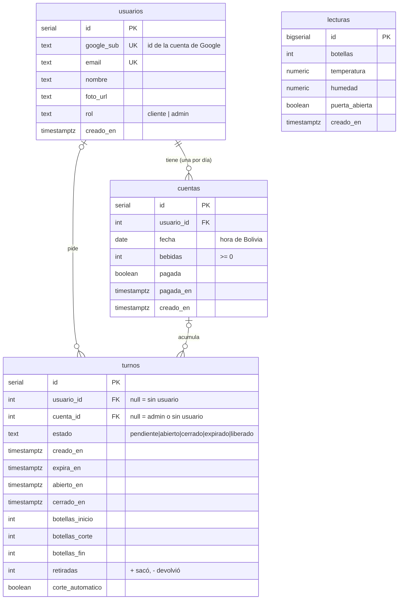

# Base de datos (P2)

PostgreSQL alojado en **Supabase**, usado **solo como base de datos**. El backend Express se conecta directo con el driver `pg` (Session pooler, puerto 5432, SSL). El esquema completo está en [`sql/esquema.sql`](../sql/esquema.sql) y se ejecuta una sola vez en el SQL Editor de Supabase.

Versión para Word / impresión: [`er.svg`](er.svg).

## Diagrama entidad-relación



## Tablas

### `usuarios`

Se crean en el **primer login con Google** (`insert ... on conflict (google_sub) do update`, que además actualiza nombre, email y foto en cada login).

| Columna | Tipo | Descripción |
|---|---|---|
| `id` | serial PK | Identificador interno (es el `sub` del JWT propio) |
| `google_sub` | text, único | Identificador estable de la cuenta de Google |
| `email` | text, único | Correo de Google (verificado) |
| `nombre` | text | Nombre mostrado |
| `foto_url` | text | Foto de perfil de Google |
| `rol` | text | `cliente` (por defecto) o `admin`. El primer admin se asigna por SQL |
| `creado_en` | timestamptz | Fecha de registro |

### `cuentas`

La **cuenta del día**: una por usuario y por fecha (zona horaria `America/La_Paz`). Solo guarda la **cantidad de bebidas** y si está pagada; no hay montos.

| Columna | Tipo | Descripción |
|---|---|---|
| `id` | serial PK | |
| `usuario_id` | int FK → usuarios | Dueño de la cuenta |
| `fecha` | date | Día (hora de Bolivia) |
| `bebidas` | int, `check (bebidas >= 0)` | Bebidas tomadas en el día. Las devoluciones restan, sin bajar de 0 |
| `pagada` | boolean | El admin la marca como pagada |
| `pagada_en` | timestamptz | Momento del pago (null si no está pagada) |
| `creado_en` | timestamptz | |

**Restricción `unique (usuario_id, fecha)`:** garantiza una sola cuenta por usuario y día. El backend la crea o la obtiene en una sola sentencia:

```sql
insert into cuentas (usuario_id, fecha) values ($1, (now() at time zone 'America/La_Paz')::date)
on conflict (usuario_id, fecha) do update set usuario_id = excluded.usuario_id
returning id;
```

Los administradores **no** tienen cuenta: su turno es una **reposición**.

### `turnos`

Cada fila es un **uso del refrigerador** y, a la vez, el **bloqueo**: mientras exista un turno `pendiente` o `abierto`, nadie más puede pedir uno.

| Columna | Tipo | Descripción |
|---|---|---|
| `id` | serial PK | |
| `usuario_id` | int FK → usuarios | Quién lo pidió. **null** = la puerta se abrió sin turno ("sin usuario") |
| `cuenta_id` | int FK → cuentas | Cuenta del día a la que se cobra. null para admin o sin usuario |
| `estado` | text | `pendiente`, `abierto`, `cerrado`, `expirado` o `liberado` (ver `flujo.md`) |
| `creado_en` | timestamptz | Cuándo se pidió |
| `expira_en` | timestamptz | `creado_en + 30 s`: límite para abrir la puerta (el servidor da 2 s de gracia) |
| `abierto_en` | timestamptz | Cuándo se abrió la puerta |
| `cerrado_en` | timestamptz | Cuándo se cerró, expiró o se liberó |
| `botellas_inicio` | int | Botellas al abrir (último conteo estable con la puerta cerrada) |
| `botellas_corte` | int | Última cantidad ya cobrada (apertura o corte de 2 min) |
| `botellas_fin` | int | Botellas al cerrar |
| `retiradas` | int | Total neto del uso: + sacó, − devolvió o repuso |
| `corte_automatico` | boolean | true si hubo corte por puerta abierta 2 min |

**Índice único parcial `turnos_un_activo` (el bloqueo):**

```sql
create unique index turnos_un_activo on turnos ((true)) where estado in ('pendiente', 'abierto');
```

El índice se construye sobre la expresión constante `true`, pero solo incluye las filas activas. Como todas tendrían la misma clave, **PostgreSQL rechaza una segunda fila activa** con el error `23505` (unique_violation). Si dos usuarios piden el turno en el mismo instante, uno gana y el backend responde al otro `409 ocupado`. El bloqueo lo garantiza la base de datos, no el código.

### `lecturas`

Historial que envía el ESP32 **cada 1 s** (se guardan todas). Alimenta el estado en vivo y las gráficas del dashboard.

| Columna | Tipo | Descripción |
|---|---|---|
| `id` | bigserial PK | bigserial porque crece ~86 400 filas por día |
| `botellas` | int | Conteo actual (puede ser null) |
| `temperatura` | numeric(5,2) | °C del DHT22 (null si el sensor falla) |
| `humedad` | numeric(5,2) | % de humedad relativa |
| `puerta_abierta` | boolean | Estado del MC-31 |
| `creado_en` | timestamptz | Índice `lecturas_creado_en (creado_en desc)` para la última lectura y los rangos de las gráficas |

> **Trabajo futuro:** a 1 lectura/s son ~86 400 filas por día (~2,6 millones al mes). Conviene una tarea de limpieza que borre o agregue (promedios por minuto) las lecturas de más de N días.

## Seguridad: RLS sin políticas

Supabase publica automáticamente el esquema `public` mediante su API REST (PostgREST) usando la *anon key*, que es pública. Para que nadie pueda leer ni modificar las tablas por ese camino:

```sql
alter table usuarios enable row level security;
alter table cuentas  enable row level security;
alter table turnos   enable row level security;
alter table lecturas enable row level security;
```

Con RLS activado y **ninguna política**, los roles `anon` y `authenticated` no ven ninguna fila. El backend se conecta con el usuario `postgres`, dueño de las tablas, que no queda restringido por RLS. Toda la lógica y los permisos viven en la API propia.

## Primer administrador

1. Entrar una vez a la web con la cuenta de Google del administrador (se crea como `cliente`).
2. En el SQL Editor de Supabase:
   ```sql
   update usuarios set rol = 'admin' where email = 'tu-correo@gmail.com';
   ```
   El rol se lee de la base de datos en cada petición, así que el cambio aplica de inmediato.
