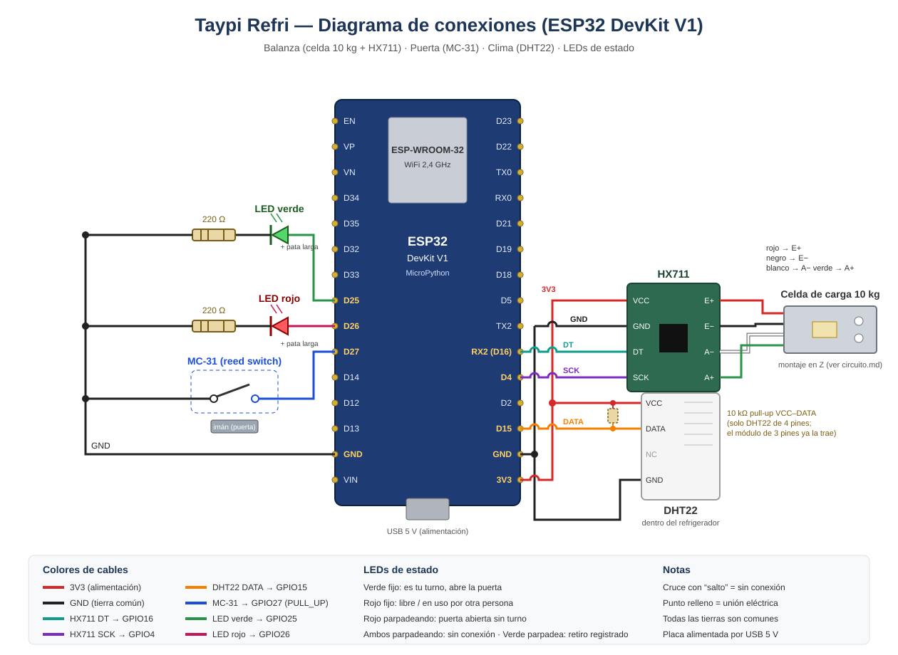

# Circuito del refrigerador (P1)



El ESP32 DevKit V1 con MicroPython lee tres sensores (balanza, puerta y clima), maneja dos LEDs de estado y se comunica por WiFi con la API. Los números de pin coinciden con `firmware/config.py`.

## Tabla de conexiones

| Componente | Pin del componente | ESP32 | Notas |
|---|---|---|---|
| HX711 | VCC | 3V3 | |
| HX711 | GND | GND | |
| HX711 | DT | GPIO16 (marcado RX2) | `PIN_HX711_DT = 16` |
| HX711 | SCK | GPIO4 (D4) | `PIN_HX711_SCK = 4` |
| Celda de carga 10 kg | cable rojo | HX711 E+ | excitación + |
| Celda de carga 10 kg | cable negro | HX711 E− | excitación − |
| Celda de carga 10 kg | cable blanco | HX711 A− | señal − |
| Celda de carga 10 kg | cable verde | HX711 A+ | señal + |
| MC-31 (reed switch) | cable 1 | GPIO27 (D27) | `Pin.PULL_UP` interno, no necesita resistencia |
| MC-31 (reed switch) | cable 2 | GND | |
| DHT22 | VCC (pin 1) | 3V3 | |
| DHT22 | DATA (pin 2) | GPIO15 (D15) | 10 kΩ de DATA a VCC solo si es el sensor suelto de 4 pines |
| DHT22 | NC (pin 3) | sin conectar | |
| DHT22 | GND (pin 4) | GND | |
| LED verde | ánodo (pata larga) | GPIO25 (D25) | cátodo → 220 Ω → GND |
| LED rojo | ánodo (pata larga) | GPIO26 (D26) | cátodo → 220 Ω → GND |

Todas las tierras (GND) son comunes.

## Alimentación

- La placa se alimenta por el **USB (5 V)**, desde un cargador de celular o la PC. El regulador de la placa entrega **3,3 V** en el pin 3V3.
- HX711, DHT22 y la celda se alimentan desde **3V3**. Así los niveles lógicos de DT y DATA quedan en 3,3 V, que es lo que tolera el ESP32 (sus GPIO **no** toleran 5 V).
- El consumo total es bajo: el ESP32 con WiFi (~100–250 mA en picos), el HX711 (~1,5 mA), el DHT22 (~1,5 mA mientras mide) y cada LED (~6 mA con 220 Ω: (3,3 V − 2 V) / 220 Ω).
- Las resistencias de 220 Ω limitan la corriente de los LEDs para no dañar el LED ni el GPIO.
- El MC-31 no lleva resistencia externa: el firmware activa la resistencia **PULL_UP interna** del GPIO27. Con la puerta cerrada el imán cierra el contacto y el pin lee 0 (`PUERTA_CERRADA_VALOR = 0`, verificable con la prueba de sensores).

## Montaje de la celda de carga (en Z)

La celda de carga tipo barra mide la **flexión**, así que necesita un montaje en Z:

```
  ┌──────────────── bandeja (botellas) ────────────────┐
  └──────────────────────────────────────────┬─────────┘
                                       [separador]  ← extremo libre
  ┌──────────────── celda de carga ───────────┴─────────┐
  └──┬──────────────────────────────────────────────────┘
  [separador]  ← extremo fijo
 ════╧══════════════════ base fija ══════════════════════
```

1. Un extremo de la celda se atornilla a la **base** con un separador (la celda no toca la base).
2. El otro extremo se atornilla a la **bandeja** con otro separador, del lado opuesto.
3. La flecha grabada en la celda indica el sentido de la carga (hacia abajo).
4. La zona central (la galga, cubierta de silicona blanca) debe quedar libre: no apoyar nada ni apretar ahí.
5. Así todo el peso pasa por la celda y esta se flexiona; si la bandeja se apoya en otra cosa, la medición falla.

## Calibración

Los valores calibrados están fijos en `firmware/config.py`, para que la placa pueda reiniciar con botellas encima sin hacer tara:

| Constante | Valor | Significado |
|---|---|---|
| `OFFSET` | 19015.3744 | lectura cruda del HX711 con la bandeja vacía |
| `ESCALA` | 107.66404 | unidades crudas por gramo |
| `PESO_BOTELLA` | 362.03836 g | peso promedio de una botella |

`botellas = max(0, round(gramos / PESO_BOTELLA))`. Como todas las botellas pesan igual, redondear absorbe el ruido de unos pocos gramos. El firmware además exige **3 conteos iguales seguidos** antes de aceptar un valor como estable.

## Justificación de los sensores

| Sensor | Para qué se usa | Por qué este |
|---|---|---|
| **Celda 10 kg + HX711** | Contar las botellas por peso. El backend cobra la diferencia entre la apertura y el cierre. | Permite saber **cuántas** botellas se sacaron sin etiquetas ni lectores en cada botella. El HX711 es un ADC de 24 bits pensado para celdas de carga. 10 kg alcanzan para ~27 botellas de 362 g. |
| **MC-31 (sensor magnético de puerta)** | Marcar el **inicio y el fin de cada uso** (eventos `apertura` y `cierre`) y medir el tiempo con la puerta abierta: a los **2 min** el ESP32 envía un `corte` y se cobra lo sacado hasta ese momento. | Es simple, robusto, sin contacto mecánico con la puerta y digital (no requiere calibración). |
| **DHT22** | Temperatura y humedad **dentro** del refrigerador, para monitorear la **cadena de frío** de las bebidas y mostrarla en el dashboard. | Mide de −40 a 80 °C (±0,5 °C) y humedad (±2–5 %), mejor que el DHT11 (que no mide bajo 0 °C). Se lee cada 5 s (necesita ≥ 2 s entre lecturas). |
| **LEDs verde y rojo** | Indicar al usuario si es su turno, si el refrigerador está ocupado o si hay un problema. | Retroalimentación inmediata sin pantalla. |

### Significado de los LEDs

| LED | Significado |
|---|---|
| Verde fijo | Es tu turno: abre la puerta |
| Rojo fijo | Libre, o en uso por otra persona |
| Rojo parpadeando | Puerta abierta sin turno (uso "sin usuario") |
| Ambos parpadeando | Sin conexión con el backend |
| Verde parpadea (~1 s) | Retiro registrado al cerrar |

## Verificación con `firmware/prueba_sensores.py`

Antes de cargar `main.py`, comprobar el cableado:

1. Abrir Thonny, conectar el ESP32 y subir `config.py`, `hx711.py`, `sensores.py` y `prueba_sensores.py`.
2. Ejecutar `prueba_sensores.py` (F5).
3. Al inicio debe encender el **LED verde** 1 s y luego el **LED rojo** 1 s.
4. Cada 2 s imprime una línea como:
   ```
   pin=0 (CERRADA) | 5.3 °C 61.2 % | 3621.4 g = 10 botellas
   ```
5. Comprobaciones:
   - **Puerta:** abrir y cerrar; `pin` debe cambiar. El valor con la puerta **cerrada** va en `PUERTA_CERRADA_VALOR`.
   - **DHT22:** muestra temperatura y humedad. Si aparece `None` o "DHT22 sin respuesta", revisar DATA en GPIO15 y la resistencia de 10 kΩ.
   - **Balanza:** sin botellas debe marcar ~0 g; con N botellas, N botellas. Si sale "El HX711 no responde", revisar VCC, GND, DT (GPIO16) y SCK (GPIO4). Si el peso sale negativo al poner carga, intercambiar A+ y A− o invertir la celda.
