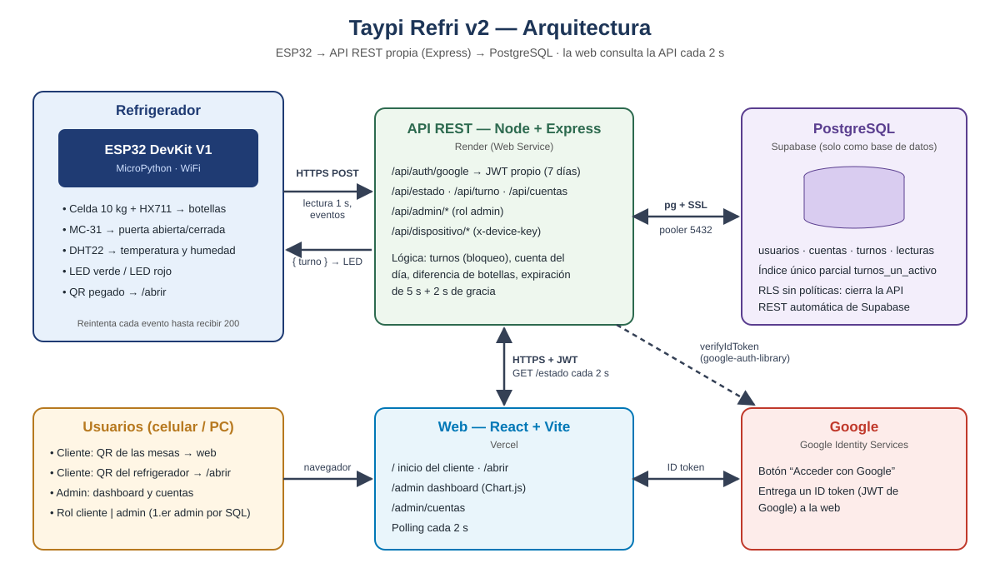
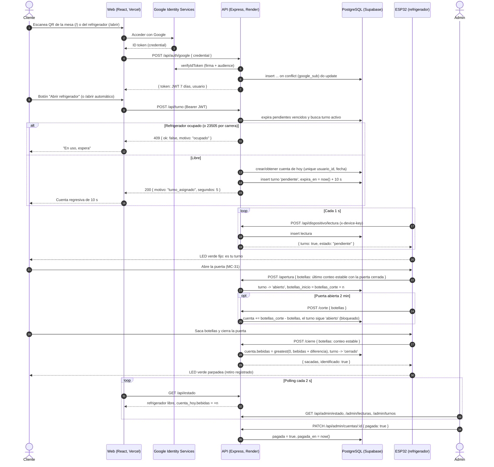
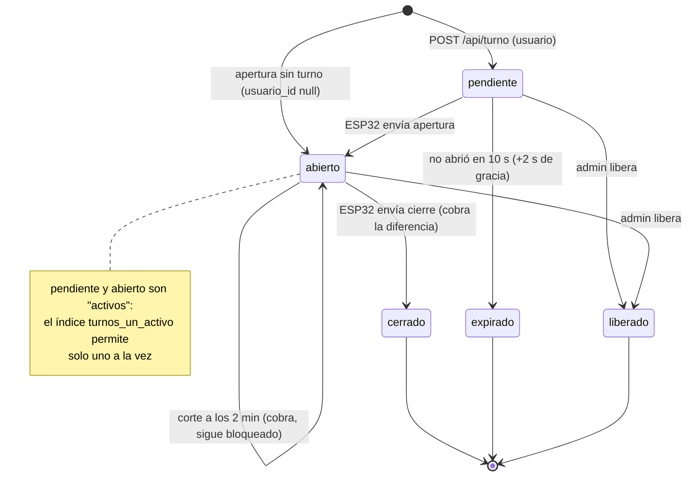

# Flujo del sistema

## Componentes

| Componente | Tecnología | Dónde corre |
|---|---|---|
| Dispositivo | ESP32 DevKit V1 + MicroPython | En el refrigerador |
| API REST | Node 24 + Express 5 | Render |
| Base de datos | PostgreSQL | Supabase (solo como BD) |
| Web | React + Vite, Chart.js | Vercel |
| Login | Google Identity Services + `google-auth-library` | Google / backend |

## Cómo entra el usuario

- **QR en las mesas** → abre la web (`/`): el cliente inicia sesión con Google y ve si el refrigerador está libre y su cuenta de hoy.
- **QR pegado en el refrigerador** → abre `/abrir`: tras iniciar sesión, la web **pide el turno de inmediato** (sin pulsar ningún botón).
- En `/`, el botón **"Abrir refrigerador"** solo aparece cuando está libre; al pedir el turno se muestra una **cuenta regresiva de 10 s**.

## Diagrama de secuencia de un uso completo

### Reglas clave

1. **Una cuenta por usuario y por día** (hora de Bolivia). Se crea al pedir el primer turno del día.
2. **10 s para abrir** desde que se asigna el turno; el servidor da **2 s de gracia** por la latencia (el ESP32 se entera del turno en ≤ 1 s mediante su lectura).
3. El ESP32 envía **`apertura`** con el último conteo estable con la puerta cerrada y **`cierre`** con el conteo estable al cerrar. El backend calcula la diferencia: `sacadas = botellas_corte − botellas`.
4. **Devolución**: si al cerrar hay más botellas, la diferencia es negativa y resta de la cuenta, **sin bajar de 0**.
5. **Turno de admin = reposición**: no se crea cuenta; el aumento queda registrado en `turnos.retiradas` (negativo).
6. **Corte a los 2 min**: si la puerta sigue abierta, se cobra lo sacado hasta ese momento y el turno **sigue bloqueado** para el mismo usuario hasta el cierre real.
7. **Apertura sin turno**: se registra un turno con `usuario_id = null` ("sin usuario"); el LED rojo parpadea.
8. **Reintentos**: el ESP32 guarda los eventos en una cola y los reenvía **en orden** hasta recibir 200. Un evento repetido se ignora porque el estado del turno ya cambió (una segunda `apertura` encuentra el turno ya `abierto`; un segundo `cierre` no encuentra turno abierto).
9. **Liberar**: si el refrigerador queda trabado, el admin puede liberar el turno activo (`liberado`).

## Estados de un turno

| Estado | Significado | ¿Bloquea el refrigerador? |
|---|---|---|
| `pendiente` | Pidió el turno; tiene 10 s para abrir | Sí |
| `abierto` | La puerta está abierta (con o sin usuario) | Sí |
| `cerrado` | Se cerró y se aplicó el cambio a la cuenta | No |
| `expirado` | No abrió a tiempo | No |
| `liberado` | Un admin lo canceló | No |

La expiración no usa tareas programadas: `expirarTurnos()` se ejecuta al inicio de cada operación (el ESP32 llama cada 1 s, la web cada 2 s), así que un turno vencido se libera en ~1 s.

## LEDs según el estado

| Situación | LED |
|---|---|
| Turno asignado a alguien (`turno: true`) | Verde fijo |
| Libre o en uso por otro | Rojo fijo |
| Puerta abierta sin turno (`sin_usuario: true`) | Rojo parpadeando |
| Sin WiFi o la API no responde | Ambos parpadeando |
| Cierre con retiro identificado | Verde parpadea ~1,2 s |

## Web

| Ruta | Quién | Contenido |
|---|---|---|
| `/` | Cliente | Login con Google; refrigerador libre / en uso; botón "Abrir refrigerador" solo si está libre; cuenta regresiva de 10 s; cuenta de hoy |
| `/abrir` | Cliente | Destino del QR del refrigerador: pide el turno de inmediato |
| `/admin` | Admin | KPIs, gráficas Chart.js (botellas en el tiempo; temperatura y humedad), polling cada 2 s, botón "Liberar refrigerador", últimos usos |
| `/admin/cuentas` | Admin | Cuentas impagas y pagadas; "Marcar pagada" |
